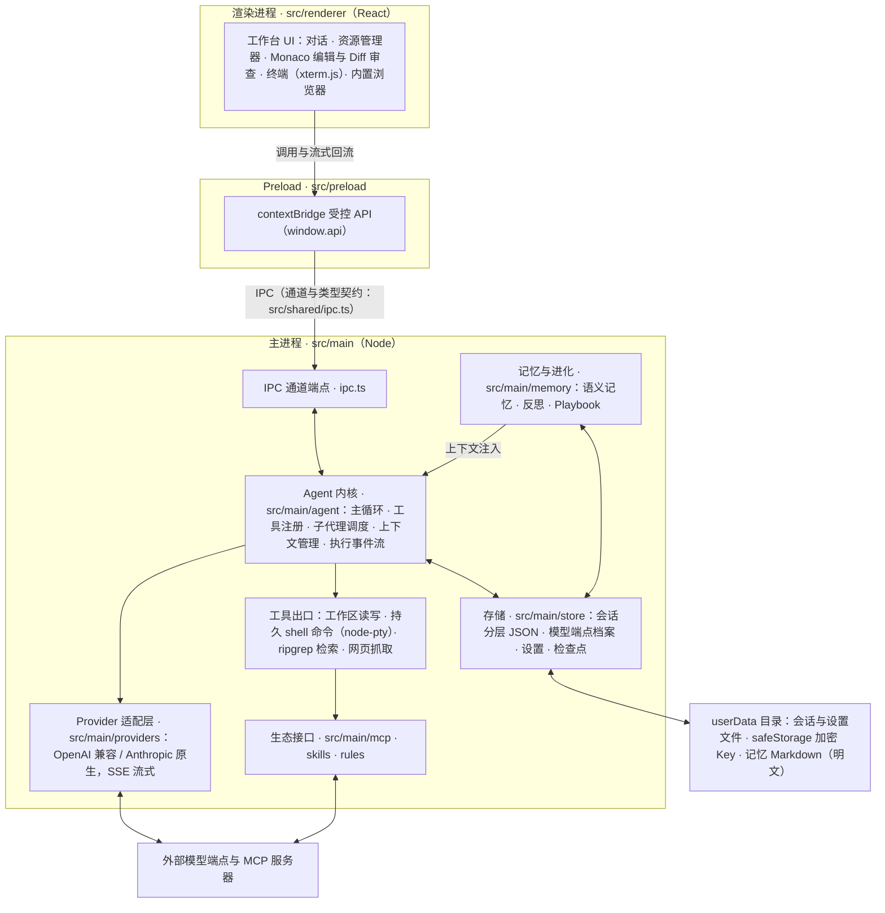

# 九十里路 · Jiushililu

> 行百里者半九十。一个**会自己长经验**的全能 AI 工作台 —— 越用越好用，越用越懂你。

「九十里路」是一个 Electron 桌面端的全能型 AI Agent 工作台。它不与框架、记忆层、MCP 生态竞争，
而是把力气花在 **Agent 内核与自进化闭环**上：干活（Generator）→ 复盘（Reflector）→ 沉淀（Curator）→ 经验手册自动回注上下文（ACE）。

- **模型全自定义接入**：不内置任何模型与 API Key，OpenAI 兼容协议 + Anthropic 原生协议双适配；
  端点档案化管理（每端点独立 Key，经 safeStorage 加密），支持免保存拉取模型列表；思考强度与上下文窗口可在输入框就地调节，档位按模型声明
- **安全底盘**：命令白名单、Key 加密存储（safeStorage）、操作审计、人工卡点
- **学习载体**：核心运行内核自研，编辑器、终端等外围能力复用成熟项目；架构与可复现验证随源码提供

[官方仓库](https://github.com/Gazer-887/jiushililu) · [下载与已发布版本](https://github.com/Gazer-887/jiushililu/releases) · [问题反馈](https://github.com/Gazer-887/jiushililu/issues) · [变更记录](CHANGELOG.md)

## 安装

- **Windows x64**：GitHub Releases 提供 `Jiushililu-Setup-<version>.exe`（NSIS 安装版）与
  `Jiushililu-Portable-<version>.exe`（便携版）双产物，当前仅发布 Windows x64 包。
- 首次运行后在设置页配置模型端点即可使用，无任何预置模型与凭据。
- 源码运行：仓库根目录执行 `npm install` 后 `npm run dev`。

## 当前状态

**v0.13.111** 是当前软件包版本，也是最新已发布安装包的版本。本版包含阶段性 3 的供应商快捷接入与普通/FAST 速度策略，并一并纳入 2026-10-25 提交的源码增量（对话内预览、真实终态、记忆来源与经验召回）。源码集成完成不等于 1.0 定版；下载前请核对 [Releases](https://github.com/Gazer-887/jiushililu/releases) 的版本及说明。

| 范围 | 当前能力与边界 |
|---|---|
| 模型与工作台 | OpenAI 兼容与 Anthropic 原生双协议；流式对话、多会话、Monaco 编辑与差异查看、资源管理器、持久终端、计划批准与检查点回滚。模型端点和凭据由用户配置。 |
| 对话内预览（源码新增） | 输入附件、历史消息与成功写入的文件卡可预览文本、Markdown、静态 HTML、PDF、Word/Excel 内容、图片及 WAV/MP4；发送时副本可在重启后查看。本地预览不等于文件已作为多模态内容发送给模型，详见[预览说明](docs/对话内预览-源码阶段说明.md)。 |
| 真实运行结果（源码新增） | 区分完成、失败、取消、拒绝、未知与截断，保留部分回复；命令/MCP 结果贯通执行卡、任务和时间线。已知用量保留且不重复累加，未知不补零，用量完整性与业务终态独立；已落盘结果可跨会话和重启重读。取消不撤销已发生的副作用。 |
| 记忆与经验召回（源码新增） | 反思候选绑定来源会话、旧记录缺来源明确提示，条目合并保留去向；经验手册的规范标签参与条件自动召回，仅自定义标签可手动召回，保存不保证每轮注入。候选仍需批准生效，详见[记忆说明](docs/记忆索引与故障恢复.md)。 |
| 工具与生态 | 文件、命令、搜索和网页工具；技能、分层规则、MCP 客户端与子代理。宿主内置浏览器默认可用，独立开关与站点授权控制操作，未知风险逐次确认。 |

内置浏览器与日常 Chrome/Edge 登录态不互通；页面文本与截图可能随模型请求发送给服务商，站点授权不保证覆盖所有外部副作用。桌面控制依赖外部 MCP 与用户授权。Office 编辑及格式转换、完整 IDE 能力、插件市场等后续形态尚未作为本次能力交付；会话历史全文搜索也未实现。

已发布版本的逐版变化见 [CHANGELOG](CHANGELOG.md)，当前源码能力见[功能汇表](docs/功能汇表.md)。

> ⚠️ **关于记忆的安全声明（如实，不是免责套话）**
> 记忆层做了三道防线：**架构守卫**（记忆层代码物理上碰不到权限设置）、**写入侧判定**
> （授权语义拒写 + 凭据形状硬拒）、**可见性**（写入痕迹面板 + 巡检区）。
> 但它们是**必要非充分条件，不是"已解决"**：判定是关键词与形状匹配，可被同义改写绕过；
> 只读权限档也具备**出境与操作远端页面**的能力；记忆文件是 userData 下的**明文 markdown**，
> 本机任意进程可读。请把巡检区当习惯用，别把护栏当承诺信。
> ⚠️ 自动捕获（反思）会**读会话正文**并可能产出候选记忆；候选在用户批准前**不进注入索引段**，
> 且**物理隔离**在独立目录。但反思本身是一次**出境的模型调用**，请据此决定是否开启。

## 架构

进程与数据流（渲染进程 / preload 受控桥 / 主进程）：



要点：渲染进程不接触 Node 与 Electron API，一切经 preload 白名单桥；IPC 通道名字面量只在
`src/shared/ipc.ts` 定义一次，主/渲染两侧共用类型契约；模型流式响应由 `chat-emitter` 单一发送口
回流界面。

## Benchmark

复现命令（均在 `package.json` scripts，从仓库根执行；Windows x64 为本项目实测基线平台）：

| 命令 | 测什么 | 是否调用模型 |
|---|---|:--:|
| `npm test` | 单元测试（Vitest，含真起子进程的用例） | 否 |
| `npm run bench` | vitest 基准：会话存储三档量级、单会话巨型文件重写、记忆 100 条满载（阈值断言） | 否 |
| `npm run bench:all` | 聚合基准：跑 bench + 环境对照（裸同步读 ms/文件），JSON 与 Markdown 报告落 `bench/`（不入库），与上一轮读数对比 | 否 |
| `npm run test:e2e` | Playwright 端到端冒烟（驱动真 Electron 入口，Linux CI 走 xvfb） | 否 |
| `npm run evals` | L2 在线评测（pass@k，`--repeat=N` 多次采样，报告落 `bench/`） | **是，消耗真实额度** |
| `npm run bench:window` | 工具输出窗口化 A/B 校准（需先 `npm run build`；一次启动只跑一臂） | **是，消耗真实额度** |

归档读数（判读阈值类结果时务必带上 `bench:all` 报告首行的环境对照）：

| 读数 | 命令 | 实测条件 |
|---|---|---|
| 单元测试 1942 通过 / 1 跳过 | `npm test` | 2026-09-21，Windows x64，全量约 15s |
| 记忆 100 条满载读取阈值内（list 中位数 ≤ 45ms） | `npm run bench:all` | 2026-09-17，Windows x64，Defender 实时防护开启（裸同步读底噪 ~0.47ms/文件） |
| 记忆加载缓存优化后满载基准耗时约 -63% | `npm run bench:all` | v0.13.63 收口三跑实测（2026-09-18，同上环境） |
| 会话切换 765ms → 281ms（卡顿帧 87 → 2） | 无一键复现脚本 | v0.13.50 收口真机渲染实测（2026-09-16，Windows），单次对照 |
| L2 评测 pass@k 3/3 | `npm run evals -- --repeat=3` | 2026-09-16，deepseek flash 端点；结果随所选模型与端点变化，不构成横向指标 |

**方差声明**：本地实测显示模型类 A/B 单轮抖动可达数倍（n=1 对照组曾测得 3.3 倍方差），因此本仓库
的结论一律要求多次采样取中位数；README 中不出现「提升 N%」式的单轮效果声明，省 token 档位的
校准已于2026-09-13按多次采样完成，结论为保持8k/12k/0.72不变（方差高于可测效应）。该结论限于当时任务形态，不代表所有模型的最优参数。

CI（GitHub Actions，ubuntu-latest）在 master push 与 pull request 上跑 lint / typecheck / build /
单元测试与 e2e 冒烟（e2e 在 xvfb 下驱动真 Electron 入口）。

## 开发

```bash
npm install        # Electron 二进制自动走 .npmrc 里的国内镜像
npm run dev        # 开发模式（热更新）
npm run build      # 构建（产物在 out/）
npm start          # 运行构建产物（冷启动）
npm run dist       # 打包 Windows 安装包 + 便携版（产物在 dist/）
npm test           # 单元测试
npm run typecheck  # 类型检查
npm run lint       # ESLint
```

> 换应用图标：替换 `resources/icon-source.jpg` 后运行 `scripts/make_icons.py`（需 Pillow），重新 `npm run dist` 即可。

## 目录结构

```
src/
  main/         主进程
    agent/        Agent 内核：主循环、工具注册、子代理调度、上下文、执行事件流
    providers/    模型适配层（OpenAI 兼容 / Anthropic 原生、SSE）
    store/        持久化：会话、设置、模型端点、检查点、数据目录
    memory/       语义记忆、反思、Playbook
    mcp/ skills/ rules/   MCP 客户端、技能加载、规则注入
    retrieval/   代码检索（ripgrep）
  preload/      预加载脚本：contextBridge 受控桥
  renderer/     渲染进程：React UI
  shared/       主/渲染共享类型与 IPC 通道契约
tests/
  unit/         单元测试（Vitest）
  e2e/          端到端冒烟（Playwright）
  bench/        vitest 基准
  evals/        L1 场景回归
bench/          基准与评测的历史报告（git 忽略，本机可复现）
config/         全部构建 / 类型 / 检查 / 打包配置
scripts/        门禁、打包校验、评测驱动等工具脚本
.github/        CI 工作流
```

公开能力、边界与使用说明见 [docs/功能汇表.md](docs/功能汇表.md)、[模型接入参考](docs/模型接入参考.md)与[浏览器接入](docs/浏览器接入.md)。

## License

MIT
